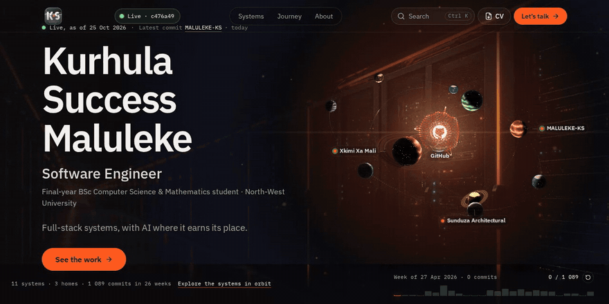

  <picture>
    <source media="(prefers-color-scheme: light)" srcset="https://capsule-render.vercel.app/api?type=waving&color=0:F6F3EE,60:FBE1D3,100:FF5B1F&height=230&section=header&text=Maluleke%20Kurhula%20Success&fontSize=46&fontColor=16181C&fontAlignY=38&desc=Software%20Engineer%20%2B%20AI&descSize=18&descAlignY=58&animation=fadeIn" />
    
  </picture>

  

  

    
    
    
    
  

### Hi, I'm Kurhula

I design and build software that people and businesses rely on: websites, web apps, business systems and AI assistants, from the first plan to the live product. I'm a final-year **BSc Computer Science & Mathematics** student at North-West University in South Africa, and I founded **[KSDRILL-SA](https://github.com/KSDRILL-SA)**, where I build these systems.

**Now:** finishing my degree · version 2 of [my platform](https://maluleke-ks.vercel.app) just shipped · open to full-time, contract and remote roles.

  
  
  
   Live numbers, read from my platform's own API.

My home page, live: each world is one of my systems, turning around GitHub, where every commit lands.

## What I do

<table>
  <tr>
    <td width="33%" valign="top">
      <b>Websites &amp; web apps</b> 
      Fast and built for phones first, so they work for everyone who visits.  
      Next.js · React · Angular · Tailwind
    </td>
    <td width="33%" valign="top">
      <b>Business systems</b> 
      The databases, logins and dashboards behind a product, built to stay secure and correct.  
      PostgreSQL · FastAPI · Node.js · Prisma
    </td>
    <td width="33%" valign="top">
      <b>AI that helps</b> 
      Assistants and automation that answer from real data, not guesses.  
      LangChain · RAG pipelines · ChromaDB
    </td>
  </tr>
</table>

## Featured work

<table>
  <tr>
    <td width="33%" valign="top">
       
      <b>Xkimi Xa Mali</b> · Fintech 
      A private savings collective platform, built for real money and real family stakes. 
      <a href="https://maluleke-ks.vercel.app/systems/xkimi-xa-mali">Read more</a> · <a href="https://xkimixamali.co.za">Live site</a>
    </td>
    <td width="33%" valign="top">
       
      <b>Sunduza Architectural</b> · Architecture &amp; construction 
      Architectural and project management systems for a construction client. 
      <a href="https://maluleke-ks.vercel.app/systems/sunduza-architectural">Read more</a> · <a href="https://sunduza-architectural.vercel.app">Live site</a>
    </td>
    <td width="33%" valign="top">
       
      <b>MALULEKE-KS</b> · This platform 
      A full-stack portfolio where every claim is backed by real rules, tests and an audit trail. 
      <a href="https://maluleke-ks.vercel.app/systems/maluleke-ks">Read more</a> · <a href="https://maluleke-ks.vercel.app">Live site</a>
    </td>
  </tr>
</table>

→ Every system, with its story and proof: **[maluleke-ks.vercel.app/systems](https://maluleke-ks.vercel.app/systems)**

## Core skills

  

→ The full stack, and the systems that prove each skill: **[maluleke-ks.vercel.app/about](https://maluleke-ks.vercel.app/about#skills)**

## How I work

1. **Agile delivery.** Work moves in small pieces, each one working and tested, shipped and reviewed in short sprints.
2. **The full software life cycle (SDLC).** Plan, design, build, test, release and maintain, with every stage written down.
3. **The database life cycle (DBLC).** The data is designed, built and evolved as carefully as the code.
4. **No surprises.** When something goes wrong, it's easy to see and quick to fix.

## Where I lead

- **[KSDRILL-SA](https://github.com/KSDRILL-SA)**, Founder & Principal Engineer: AI systems, fintech, SaaS, EdTech and GovTech
- **[GrowthCore-Solutions](https://github.com/GrowthCore-Solutions)**, Co-Founder: web development, digital marketing and analytics

## Open to

Full-time, part-time, contract and remote work in **full-stack, backend, AI/ML and systems architecture**, plus partnerships and social-impact projects.

   
  
  
    
  <em>The sky is the limit — KSDRILL SA</em>
    
  
  

